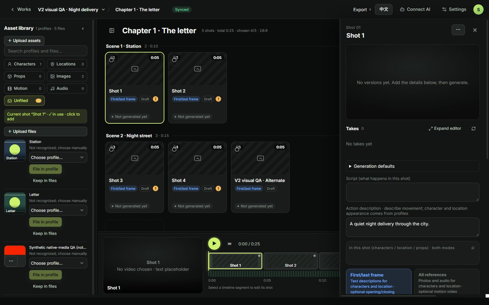
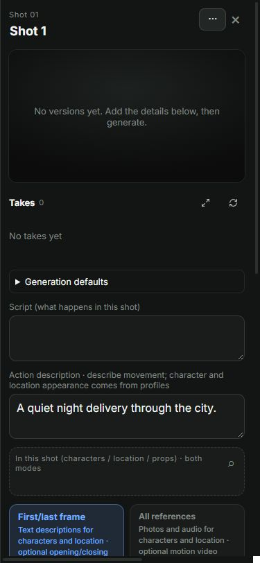
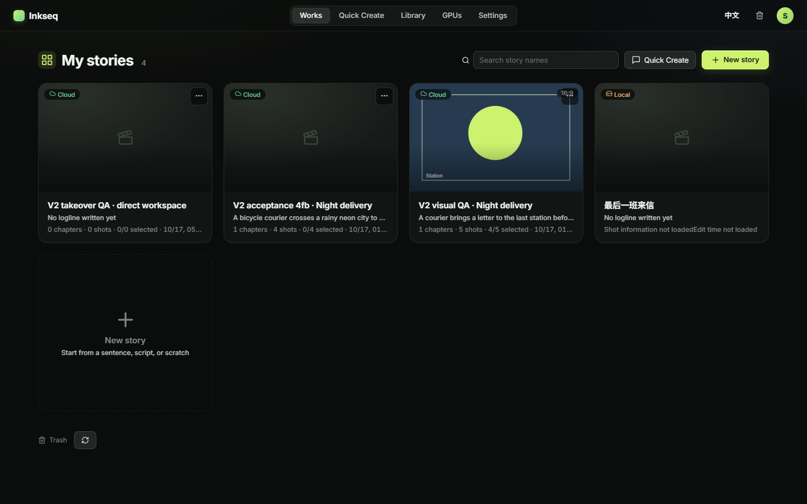
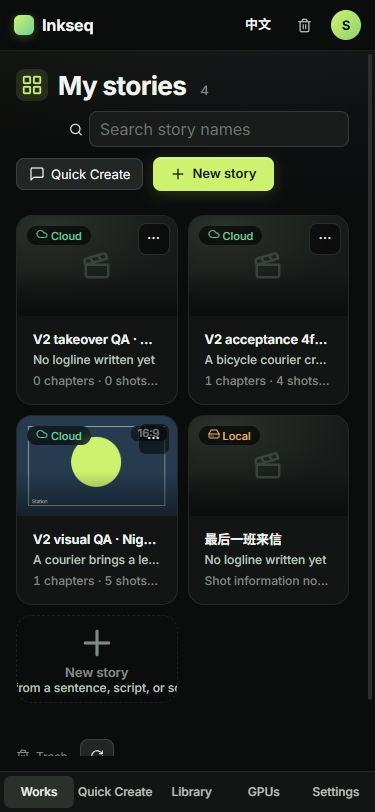

# #251 prototype-component acceptance

Accepted immutable staging candidate: `722e46ebc0303f1b3f1b294ac7b049dbedd77480`, canonical frontend source `cee88d76` (design PR61, merge7b0b1fd4). Original publication run39009319080/1; candidate SHA `3aa4fecb9f858817a945c44597797c3d41772dfcaf29c3d1cab55981cd8496c5`. Browser: existing Chrome extension, Monash, superdan; observations2026-10-17 approximately06:31–07:00UTC. No credential/login reset.

## Actual prototype / staging pairs

All source screenshots are unmodified PNGs. Prototype uses simulated data; staging uses authorized synthetic QA records and ordinary live APIs.

| Page | Prototype1440×900 | Staging1440×900 | Prototype375×812 | Staging375×812 |
|---|---|---|---|---|
| home |  |  |  |  |
| quick |  |  |  |  |
| library |  |  |  |  |
| story |  |  |  |  |
| gpu |  |  |  |  |
| settings |  |  |  |  |
| trash |  |  |  |  |

## Observed behavior

- Works: actual cloud/local entries, search, restored entry, normal new-story dialog. Cover badges were computed at11px rather than54px. A newly created cloud QA story opened the card-wall workspace directly; the old seven-step wizard is absent.
- Quick Create: existing owned conversation and real three-take metadata group loaded. Compare-two toggles and selection layout worked. Take2 star saved through the real API and was subsequently restored to its original unstarred state. Navigating to Library and back retained the selected conversation, expanded take group and unsent input. The test input was then cleared without submitting.
- Quick safety: these three takes are **awaiting confirmation**, not completed video jobs. The absence of a live worker disables execution with an original actionable reason. No paid generation was submitted solely for visual acceptance.
- Library: eight existing QA images, tags/source-story/usage metadata and thumbnails loaded; both desktop side panel and phone full-screen detail dialog worked. Inbox remains truthfully unavailable. No fabricated media or cross-owner reads were used.
- Story: two scene groups/five shots, library tabs, bottom player/timeline and right editor drawer rendered. Selecting a timeline shot updated the real project/entity URL. Phone drawer and its close action worked, including controls derived from current capabilities. The fixture has no generated workbench versions; its missing saved-character reference is reported honestly.
- Story refresh: the shareable project/entity URL remains intact. On a document refresh the existing local-draft safety prompt preserves local work; choosing Open linked story restores the exact cloud story and shot. This original guard is retained intentionally.
- GPUs: real staging queue and machine summary loaded with zero active machines. The normal read-only provider query returned five actual grouped5090 quotes with enabled launch entry points. No rental or lifecycle mutation was performed to reproduce prototype rows. No invented preparation progress or cost was shown.
- Settings: account/defaults/budget/admin routes loaded; defaults→admin Back and Forward restored the correct query tab. The existing human-admin all-account audited budget/price editor loaded all six staging account rows including shared GPU/generation budgets. No allowance, price, credential or daily safety value was changed.
- Trash: a newly created disposable QA story was moved through the normal recoverable trash flow and restored through the original API. Counts1→0 and the returned Works entry were verified. No permanent deletion, expiry or generation replay occurred.
- SPA navigation: all six top-level entries shared the same observed document loader ID; earlier Quick→Library→Quick also retained the loader. Phone width/scrollWidth was375/375 for all six pages and Story. Bottom navigation/drawers/actions remained reachable.

## Deliberate differences and coverage limits

- The prototype's sample generated videos, stock rows, prices, cost counters and expiry are not business truth. Staging displays its real owned records, live quotes, empty/blocked states, non-expiring trash and original confirmation/owner/resource/budget rules.
- Screenshots capture existing preflight/take metadata and empty generated-version states. Fresh generation/playback/download is **not claimed** for this Low-risk view-layer batch. The native execution/media/storage source and pinned native source-index bytes are unchanged versus the accepted F boundary; prior genuine staging website/Agent video and separate-audio qualifications are reused only for those unchanged paths. No foreign-owned output was opened to manufacture a loaded screenshot.
- Existing server-origin diagnostics/cloud-status notices may retain their original Chinese text in an English view. The view retains the exact diagnostic rather than replacing it with a generic failure.
- Administrative authorization, snapshot/CAS, pending-write recovery, pagination/generation fences, retired-cap and invoice-pending semantics are retained from F/#255. The26 affected financial model tests passed; ordinary Agent denial is checked separately. Browser budget writes were intentionally not repeated because this port changes presentation, not authority.

## Validation and release evidence

- Local combined frontend suite658/658; final affected checks/build passed; canonical and integration required CI passed.
- H3 PR258 and design PR61 merged. Source merge is separate from deployment.
- Sole staging deployment7ba390be: Success/0. Exact postflight4a53ce07 matched all three manifests,13 frontend files, actual OCI descriptor/config chains and healthy app/controller/dstack.
- Reviewed offline rehearsal59234fd1: Success/0, exact candidate, network-none temporary PostgreSQL, original dump identity unchanged, prior intents/helpers retained; no production DB copy published.
- Production pre-promotion read-only census3238c01c: acceptedF remains app_ready/no pending release; all11 retained financial/compatibility fields unchanged. No reservation recovery/refund/settlement replay.
- Protected owner instances56330848 and56336890 were not operated on. No test GPU was rented in this takeover; incremental test GPU spend isUSD0.
- Production promotion: pending final exact acceptance metadata and protected same-artifact operation; record the original promotion/postflight in #251 rather than inferring it from this report.

## Follow-up: completed production promotions and native media acceptance

This section appends later evidence to the original report above. Its earlier pending statements describe the state at that earlier checkpoint.

| Accepted artifact | Completed production operation | Original exact postflight |
|---|---|---|
| Combined release `722e46ebc0303f1b3f1b294ac7b049dbedd77480`; candidate SHA256 `3aa4fecb9f858817a945c44597797c3d41772dfcaf29c3d1cab55981cd8496c5` | Protected same-artifact promotion `7deb4855-4f00-47d3-a938-f8fe06fd13f9`: Success/0, completed2026-10-17 06:59UTC | `c518d29c-6980-4984-96b0-8aaaeb505820`: Success/0; all three manifests,13 frontend files and actual OCI descriptor/config chains verified. The original failed optional-health formatter receipt remains retained; the correction did not redeploy. |
| Frontend-only native-read correction `4144ad61fc6784146648e2f1a584118f0590b923`; candidate SHA256 `5b7cd2e3ca64ac940c238b2adf412212e99557e9703e6d0a96b4df4cea176928` | Protected same-artifact promotion `aeeebf7b-4021-4322-8127-0f0352fee88c`: Success/0, completed2026-10-17 07:48UTC | `fccce5e5-44a0-4dc9-b47c-fd750fefcccf`: Success/0; exact frontend manifest and all13 file hashes verified. Backend release722e, release/migration/target byte pins, app/controller/dstack container IDs and images remained unchanged. |

### Native Story / Works staging evidence

The accepted4144 frontend serves original owner-fenced native content URLs for previews and attachment downloads; processing/export retains its original Blob path. The following unmodified screenshots show actual staging data and the existing synthetic QA story, not simulated API responses.

| View | Desktop1440×900 | Phone375×812 |
|---|---|---|
| Story editor with loaded native references |  |  |
| Works with native covers |  |  |

- Actual Story native images completed loading; the owned512×288,3-second synthetic CPU video reached readyState4 with no media error. This is preview/read acceptance, not a newly generated H3 video.
- Works→Library→Works retained the same SPA document; phone viewport and document scroll width were both375px.
- Native isolation checks retained the existing contract: anonymous reads401, foreign-owner media404, changed browser-account hint visibly refused with `account_context_changed`. The existing Agent read matched the original206,805-byte staging fixture; machine bearer identity remains authoritative and ignores the browser-only account hint.
- Native integration local checks passed124 targeted tests and a build; the subsequent nullable-title display regression passed10 affected tests and a build. Neither result substitutes for its pending final live smoke below.

### Existing production Quick downloads

Ordinary Quick Create download buttons, followed by real browser download events, saved both the existing MP4 and separate FLAC. Full-file hashes and complete decoder runs passed for each; no new paid generation was submitted. These checks use the ordinary UI, not the browser helper that had returned `ERR_BLOCKED_BY_CLIENT`.

| Output | Bytes | SHA256 | Full decode |
|---|---:|---|---|
| MP4 video,832×480,5.167s, H.264/AAC | 2,569,894 | `c5f8daf331910b32e894efba02fba9b61b28a12fa64642cb3b87eccde8153112` | Passed |
| Separate FLAC audio,32kHz stereo,5.166656s | 813,819 | `99279cf325e19e9026a5353e770a795fc81526e339936d12ddf396573f5e1994` | Passed |

### Preserved financial and operating boundary

The original before/after financial receipts are frozen and reused; no refund, reservation recovery or settlement was repeated. The127 corrected tasks and two historical machines retain their original recovery identities. Original account/reservation/job/attempt digests,367 invoice-pending rows with unknown actual charges, and all three original unscoped/unpaused Agent connections were unchanged across the combined promotion. The later static-only promotion did not restart or replace the722e backend services or mutate these records.

No test GPU was allocated, generated on, stopped or otherwise operated on in this takeover; incremental test GPU spend remainsUSD0. Protected owner instance IDs56330848 and56336890 were untouched. This statement is about this batch's actions, not a new provider-inventory assertion.

### Remaining limits and final live smoke

- Blob-based byte processing/export is unchanged. The observed missing-Origin read failure is tracked in [#6](https://github.com/inkseq/h3-studio/issues/6#issuecomment-6231348083); native preview acceptance does not claim that path is fixed. Browser file-chooser acceptance and fresh H3 inference were not performed in this view-layer batch.
- [x] Nullable-title correction: design [PR63](https://github.com/inkseq/sixnine-design/pull/63), source `5e731ccc363fe12523648ee0958d499ed3831d8e`, and H3 [PR260](https://github.com/inkseq/h3-studio/pull/260) are merged. Exact frontend `349bbe8d997fda354d13a6449be12f9ece5ef497` passed main CI39015495328/1. Candidate SHA256 `78627643b8643689f4400a10be75966ac8795914b016d8bd2e239b8562484b87`, manifest `d9f03de106eaa1e345a6e198074a1e594e49db225d32fcf3fe1ff7ec7ab2e651`; original stagingbffbc8a8 Success/0, all13 served files matched. Existing Story navigation and native synthetic preview passed; unchanged owner-isolation and722e rehearsal evidence were reused explicitly.
- [x] Protected same-artifact production promotion `e800b99e-c8c2-45a8-a703-1c3366565403`: Success/0 at08:04:51UTC. Read-only exact postflight `291016aa-78c8-4e46-8e08-fda298dbc6ba`: Success/0 at08:05:05UTC. All13 frontend files matched. Backend722e metadata/migration/target bytes, app/controller/dstack container IDs/images and healthy/running states remained unchanged; no database, provider or financial operation was performed.
- [x] Final production Story smoke: the original owned legacy story opens without the null-title blank screen. Its existing local cloud draft was restored, never discarded or saved over the server. The genuinely generated1344×768 video reached readyState4, advanced in playback and ended at5 seconds with no media error. The editor, result-version thumbnail and timeline preview load. Ordinary Story video and separate-audio link clicks produced real browser download events. Full decoding and hashes passed for both files below. At375×812, width/scrollWidth375/375 and both attachment links were visible and unobscured. Private production media/screenshots remain local, not in this public evidence directory.

| Story output | Bytes | SHA256 | Full decode |
|---|---:|---|---|
| MP4 video,1344×768,5s,H.264/AAC | 3,630,427 | `c9ee0fce001b8a52d839f3f5f37040af255d3a5f4820a6be9b342a5bc5e2bdea` | Passed |
| Separate FLAC audio,32kHz stereo,5s | 310,870 | `df512927fe8a723161161476ff3f6f278af1425bd3f3533599c42c5780659b7b` | Passed |

One legacy card-wall thumbnail still displays Preview unavailable while the same artifact plays in the editor/timeline and its result thumbnail loads. Its precise cause is not established; it is retained with the existing media follow-up [#6](https://github.com/inkseq/h3-studio/issues/6). This report does not claim all historical thumbnail/Blob/export paths are fixed. Original stored records and cached drafts are preserved. Seven-page visual/navigation acceptance is complete within the listed scope; current production is backend722e plus frontend349bbe8. The owner preview gate was superseded by CR24/25, not represented as a human preview that did not occur.

