# #261 phone layout acceptance

Final production frontend: `0d8fad38cf2120a0baed3d24e6b3e4e30e0a5c43`; unchanged backend: `722e46ebc0303f1b3f1b294ac7b049dbedd77480`. Candidate SHA256: `f74ed61e19d5fdbc2af4901cb8df8eaf167a662d66b9de38de55b3c4c7b50287`. Required [CI39018788590](https://github.com/inkseq/h3-studio/actions/runs/39018788590) passed. This is a frontend-only release, promoted without rebuilding the accepted bytes.

## Prototype and actual staging comparison

All18 JPEGs below are unmodified375×812 captures. The private captures used `.png` filenames despite containing JPEG data; only the public extension is corrected, without re-encoding. The approved prototype has no real signed-out state: its fixed avatar and logout toast are sample UI. Its one capture per page is an authenticated geometry reference, not fabricated signed-out evidence. Both actual staging states are shown separately; staging records and images are authorized synthetic QA data. Production prompts, media, account/spend screenshots and raw operational receipts are not included in this public report.

| Page | Approved prototype geometry | Actual staging, signed in | Actual staging, signed out |
|---|---|---|---|
| Works `/` | 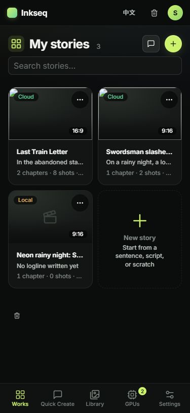 | 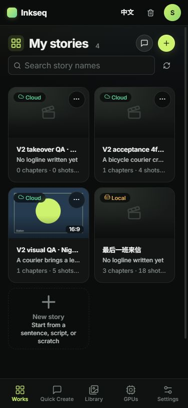 | 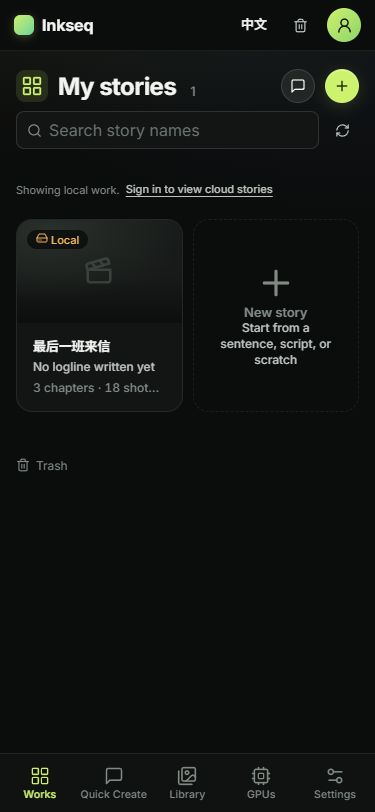 |
| Quick Create `/quick-chat` | 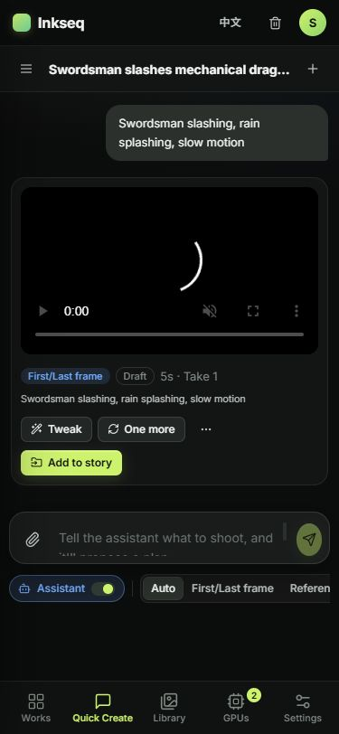 | 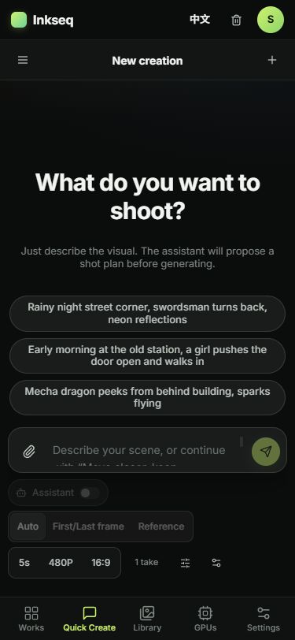 | 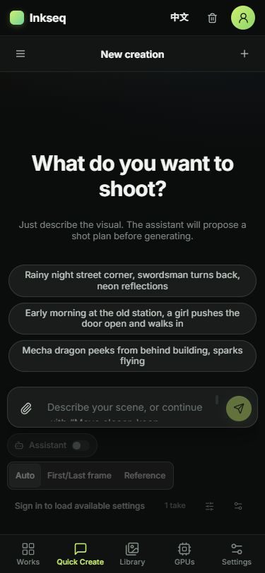 |
| Library `/library` | 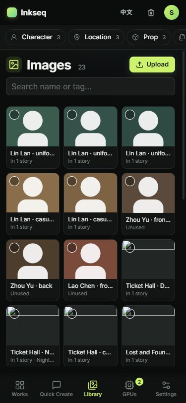 | 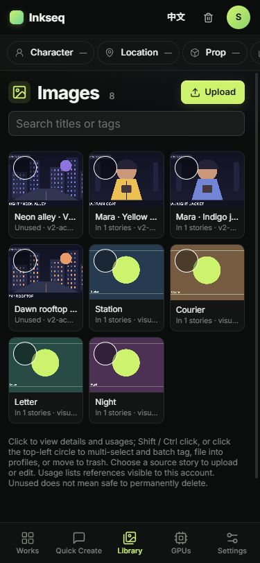 | 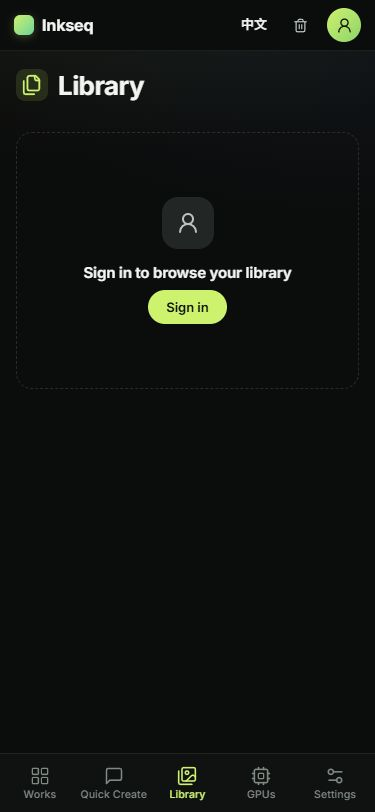 |
| GPUs `/operator` | 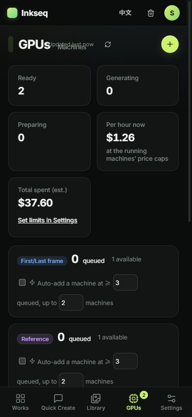 | 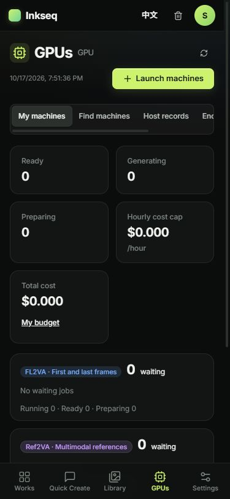 | 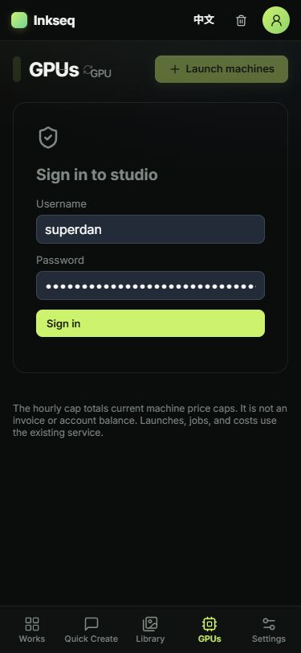 |
| Settings `/settings` | 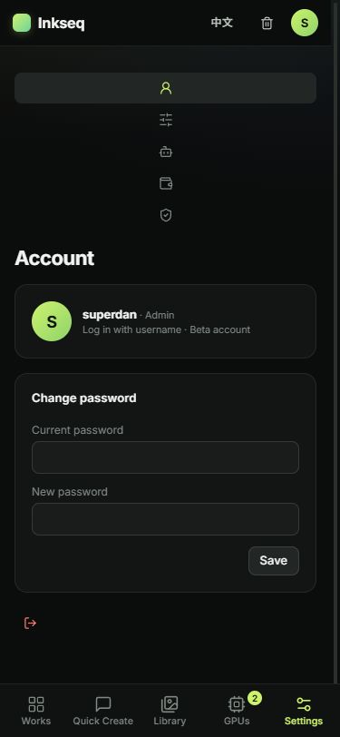 | 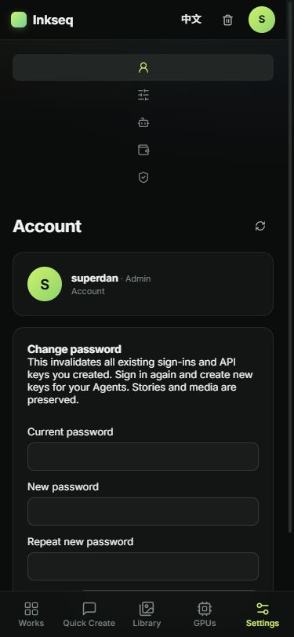 | 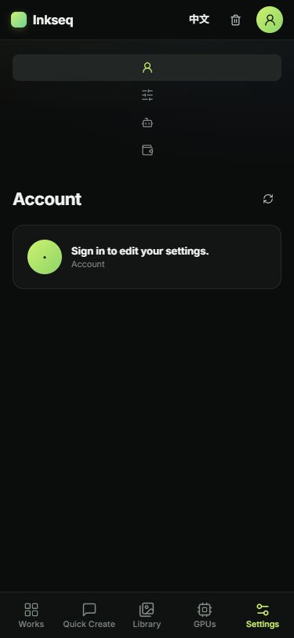 |
| Trash `/trash` | 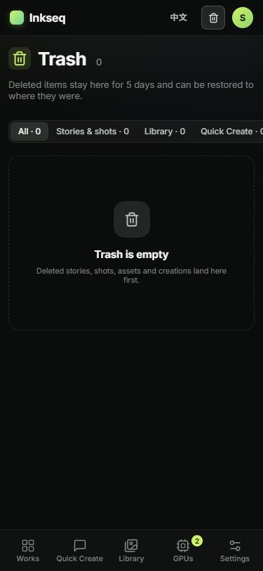 | 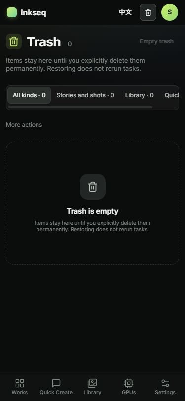 | 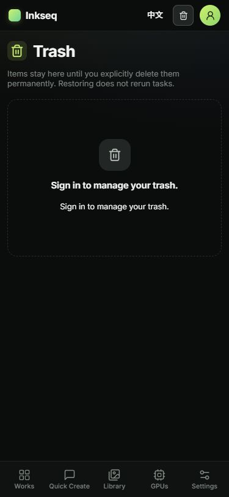 |

The original full six-page/two-state staging observations were captured on `100a07653c9bc17ee4c010d994997799f7d291cc`. Actual loaded GPU data exposed an overlap between the title/tag and observed time; that candidate was **not promoted**. The final replacement changes only P4 header classes, its refresh accessible label and phone grid rules. Eleven preceding state observations are reused explicitly for unchanged behavior. The signed-in GPU capture above is replaced with the final `0d8fad38` capture; it is not a relabeled screenshot of the failed header.

On the final GPU page, title/refresh and observed-time/launch occupy separate rows. The real timestamp is at x16/y120.30, width156.56/height15.39; title is x16/y70, width156.56/height32; refresh is x315/y69,34×34; launch is x182.56/y111,166.44×34. The timestamp no longer overlaps the title or controls. No meaningful control was removed.

## Observed behavior

- The five bottom tabs show20px icons and10.5px labels, accent selection without a pill, and safe-area padding. Existing SPA routes remain in use.
- Works uses compact creation actions, search with its icon inside the field, header refresh, a quiet signed-out notice/person entry, wrapping new-story guidance and visible card aspect chips.
- Quick Create options wrap within the phone viewport. Original composer draft, material, preflight, recipe and paid-submit behavior is unchanged.
- Library shows one clear signed-out sign-in state instead of empty filter counters. The signed-in live staging view loads its eight authorized QA images; real inventory and loading/error states remain authoritative.
- GPU title, timestamp and actions use a scoped phone grid; existing queue data, machine controls, Settings and Trash remain real service views rather than prototype data.
- All12 staging observations report viewport width375, page scrollWidth375 and no visible target smaller than34px. No horizontal page overflow was observed. Original owner/account, budget, API and provider behavior is unchanged by this phone-only batch.

## Same-artifact release and production acceptance

- Original final staging operation `7ed46c2d-13a1-4d94-b27b-8646e635ad0f`: Success/0, completed2026-10-17 08:51:16UTC. All13 served frontend files matched the immutable candidate.
- Original protected promotion `ebbbb82b-e2f8-4b0a-bd62-6df89d417b7d`: Success/0, completed08:57:53UTC.
- Original read-only exact postflight `1252d5a7-d088-41ca-94a0-b1b682e27cfa`: Success/0, completed08:58:26UTC. It verified all13 frontend hashes and accepted API compatibility. Backend release/migration/target bytes and all three backend service container IDs/images remained unchanged.
- Root completed **all12 actual production observations anew on the final frontend**, covering these same six pages signed in and signed out at375×812. Each has width/scrollWidth375 and an empty visible-small-target list. A normal logout/sign-in restored the existing account; no credential change or account workaround occurred.
- The original production browser receipt is retained privately as `qa261-20261017/production261-browser-accepted.json`, state `six_page_phone_live_production_accepted`, bound to the exact final frontend. It and production screenshots are deliberately not published here. These fresh production observations are separate from the explicit11-observation staging reuse above.

This batch performed no new paid generation, GPU allocation, provider mutation or financial operation. It does not claim new inference qualification, Blob processing/export fixes, new credentials or settlement of unknown invoices. The previous desktop acceptance remains in [#251](../251-20261017/README.md); this report covers the bounded phone corrections requested in [#261](https://github.com/inkseq/h3-studio/issues/261).
