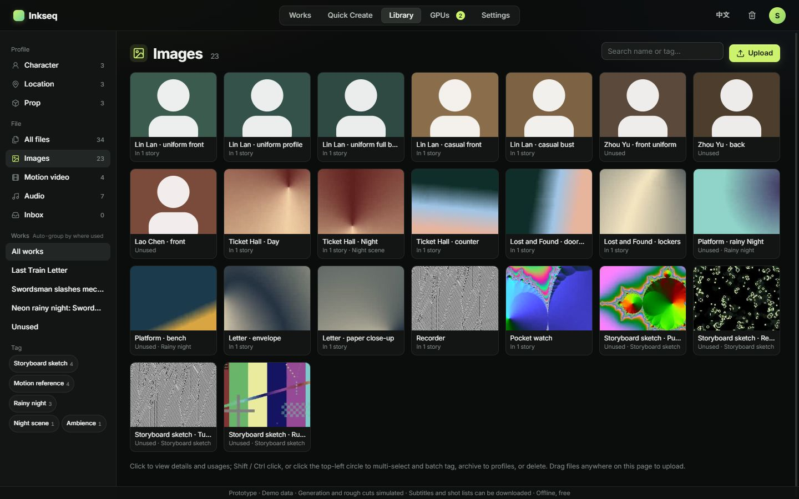
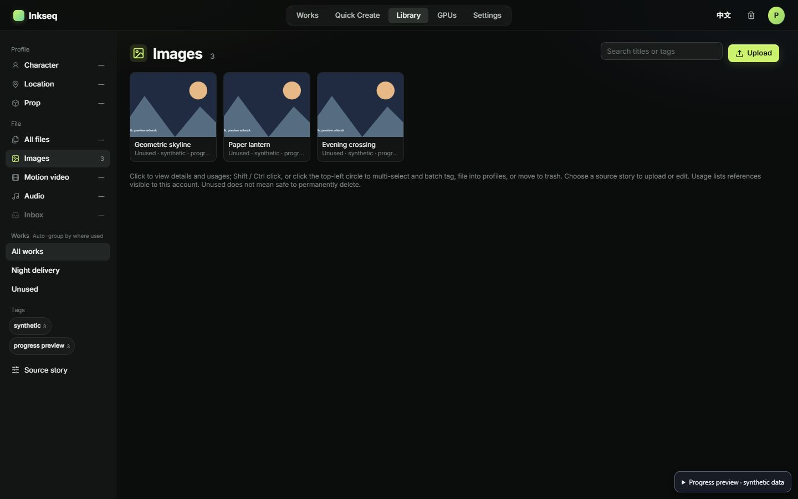
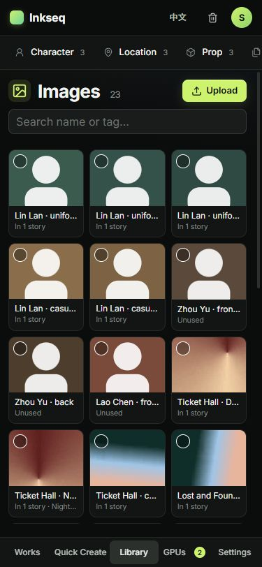
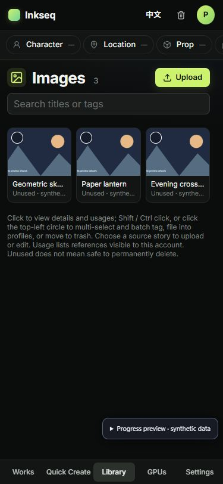

# Library visual structure checkpoint

Source: `49d58e13f67b52360f94cb96354c5a41d55e4441`, based on the actual component snapshot `68a3b573` / initial preview `81988a813`. This is a Library presentation checkpoint, not staging acceptance or an all-seven-page conformance claim.

The view uses the approved prototype's actual `libp` layout, unchanged `demo-v2.css`, sidebar groups, header/search/upload row, responsive chips, media grid, profile cards, bulk bar and detail-panel classes. Its real-service controls remain adapters over the original Library handlers. The existing native mobile dialog retains focus/Escape handling and fills the screen for Library detail. Every write, pending-operation guard, project/account check and original request/CAS remains unchanged.

The original isolated preview fell back to an OS font because its CSP correctly blocks Google Fonts. The approved prototype used Inter. The same official Inter Latin font is now served locally with its OFL license, retaining `connect-src 'none'` and same-origin resource limits. The bundle checker pins its exact SHA-256.

The four screenshots below were captured from actual Chrome pages with synthetic data at the stated viewport sizes. The prototype has 23 sample images; the preview intentionally has only three geometric synthetic images. This data difference and the synthetic-preview notice are expected. No real account or private media is shown.

| Viewport | Approved prototype | Updated actual-component preview |
| --- | --- | --- |
| 1440 × 900 |  |  |
| 375 × 812 |  |  |

At desktop the measured shared structure matches: 56px header, 210px sidebar, main padding 20px/24px, title y=80 and height=32, grid y=130, 12px card gap and 4:3 artwork. A stable scrollbar gutter prevents cards shifting when filters reduce the list. Mobile uses the prototype's horizontal filter chips, full-width search, three-column file grid and bottom navigation; measured document width remains 375px. See `geometry.json` for actual measured DOM rectangles.

Honest service adaptations remain visible: unloaded category totals are `—` (never fabricated zero); Inbox is disabled because the current Library contract has no Inbox filter; source-story selection/refresh lives in the sidebar tools; writes remain scoped to the original selected-story rules. Profile creation remains in the existing story editor. The UI retains the warning that visible usage does not authorize permanent deletion. These are not claims of new backend capabilities.

Focused existing Library/i18n checks and fixture/network-boundary checks passed (7 checks), followed by the static build and public bundle scan. Actual browser checks covered desktop/mobile rendering, selection guards, search, route Back/refresh, native detail/dialog behavior and same-origin font loading with zero API/foreign HTTP resources. Live command acceptance remains in the separate staging lane.

## Safe canonical port

Apply only the seven-file source commit `49d58e13f67b52360f94cb96354c5a41d55e4441`. The later preview/evidence commit is not part of the production source patch. `port-cas.json` records the three expected original file hashes and requires the four new files to be absent. Stop and reconcile if any original differs; do not overwrite the canonical branch/index/WIP. Root retains integration ownership.
