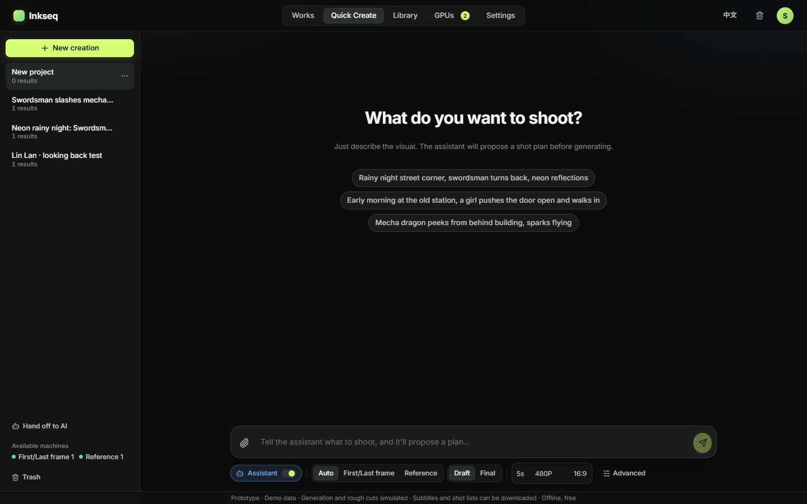
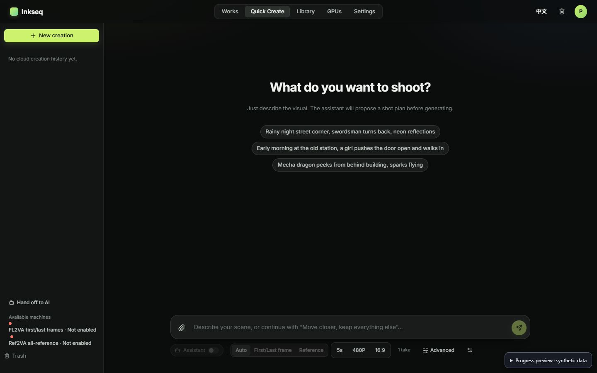
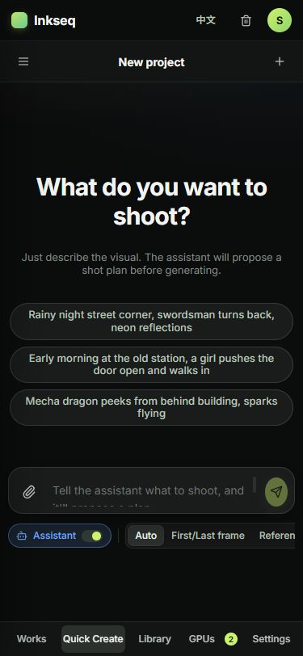
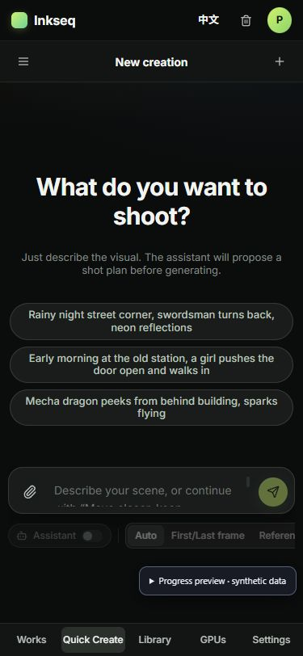

# Quick Create empty-state checkpoint

Source-only commit: `fc1c28440657988d9a5047e4edd4ac387d6559fc`, based on preview `2d5f111` and retaining Library source `49d58e1`. This is a bounded comparison of the empty/new-creation state, not full Quick Create, loaded proposal/take/result, seven-page or staging acceptance.

The view directly reuses the approved demo's `qc`, empty heading/examples, composer, responsive sidebar/drawer and mobile control-strip structure. Conflicting scoped width/height/padding overrides were removed so the original prototype stylesheet supplies the geometry. The actual account button keeps its original sign-in handler with the prototype avatar presentation. Closed phone history is hidden from interaction/accessibility while retaining its animated drawer.

The example chips call the existing draft-change handler and focus the existing composer. They do not create a conversation, send an assistant request, preflight or generate. Duration/resolution/aspect cells show only genuine schema fields and their actual current values; they invoke the existing complete control editor rather than add a new settings mutation path. Copy count, advanced controls and take preferences remain reachable. No simulated Draft/Final preset is invented where the current service does not expose one.

## Like-for-like empty-state screenshots

The demo was opened after its synthetic New creation action. The actual app uses its synthetic uncreated/empty state. The demo's seeded conversation history, simulated machine counts and enabled assistant differ from this deliberately empty/disabled preview. No real account, prompt, asset or job is present.

| Viewport | Approved demo, new creation | Actual-component empty progress preview |
| --- | --- | --- |
| 1440 × 900 |  |  |
| 375 × 812 |  |  |

The measured heading, examples and composer rectangles match at both sizes. Desktop uses the same 56px header, 250px sidebar and 868px composer. Mobile uses the same 375px document, 355px composer, 300px full-height drawer, scrollable options and bottom navigation. See `geometry.json` for actual DOM rectangles. Parameter controls remain a documented real-service adapter, and the preview notice is intentionally visible.

Four focused existing i18n/fixture checks passed, followed by build and the 24-file public artifact scan. Chrome extension browser checks confirmed example-to-draft behavior with zero writes, the original complete controls dialog, drawer opening/Escape dismissal, and Back preserving the draft and document identity. API/foreign HTTP resources remained zero. The strict preview CSP/transport and every controller, immutable pending receipt, draft fence, preflight/paid guard and real API binding are unchanged.

## Safe canonical port

Apply only the three-file source patch from `fc1c28440657988d9a5047e4edd4ac387d6559fc` after the original-file CAS in `port-cas.json` matches. No new canonical file is introduced. Stop and reconcile any difference rather than overwrite canonical WIP/index; root owns integration. The preview/evidence commit is not part of this production source patch.
